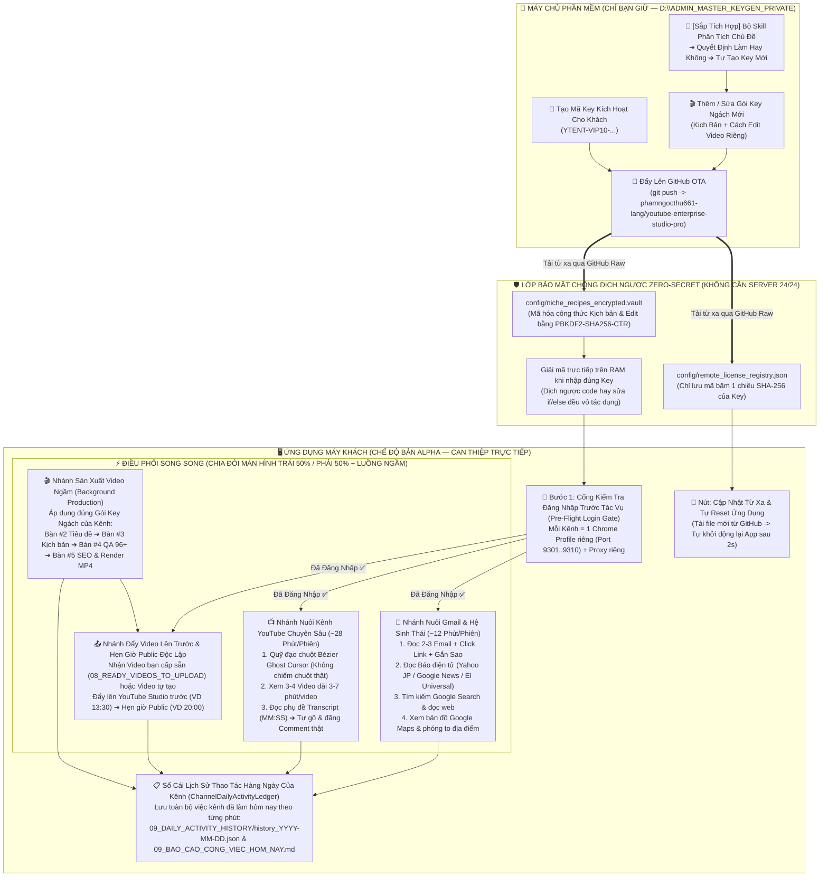

# 🗺️ BẢN SƠ ĐỒ CÔNG VIỆC & DANH SÁCH CHỨC NĂNG ĐÃ HOÀN THIỆN (`v4.0.0-Alpha`)

> **Tên Hệ Thống:** `YouTube Enterprise Multi-Agent Studio` (`v4.0.0-Alpha`)  
> **Thư mục Ứng dụng Khách:** `D:\YOUTUBE_ENTERPRISE_STUDIO\` (Không chứa bất kỳ khóa bí mật nào)  
> **Thư mục Máy Chủ Tạo Key Riêng (Chỉ Chủ Phần Mềm Giữ):** `D:\ADMIN_MASTER_KEYGEN_PRIVATE\`  
> **Kho Cập Nhật Từ Xa (GitHub OTA):** `https://github.com/phamngocthu661-lang/youtube-enterprise-studio-pro`

---

## 1. SƠ ĐỒ TỔNG THỂ LUỒNG CÔNG VIỆC CỦA HỆ THỐNG (WORKFLOW DIAGRAM)

---

## 2. BẢNG KIỂM TRA CÁC HẠNG MỤC ĐÃ LÀM ĐƯỢC 100% (ĐỂ BẠN KIỂM TRA)

| STT | Hạng Mục Chức Năng | Trạng Thái | Chi Tiết Kỹ Thuật & Nơi Kiểm Tra |
| :--- | :--- | :---: | :--- |
| **1** | **Cô lập tuyệt đối 10 Kênh / 1 Máy & Proxy riêng** | ✅ **ĐÃ XONG 100%** | Mỗi kênh nằm ở 1 thư mục `PROFILES/KENH_XX` riêng và 1 cổng CDP riêng (`9301` $\rightarrow$ `9310`). Hỗ trợ gắn và kiểm tra IP Proxy riêng cho từng kênh. |
| **2** | **Cổng Kiểm Tra Đăng Nhập Trước Mọi Tác Vụ (`Pre-Flight Login Gate`)** | ✅ **ĐÃ XONG 100%** | Trước khi Nuôi Gmail, Nuôi Kênh, Quét Studio hay Đẩy Video đều kiểm tra Cookie thực (`SID`, `SAPISID`, `LOGIN_INFO`) + DOM thật. Nếu chưa đăng nhập sẽ dừng ngay và báo rõ. |
| **3** | **Quỹ Đạo Chuột Ảo Người Thật (`CDP Ghost Cursor`)** | ✅ **ĐÃ XONG 100%** | Di chuyển con trỏ chuột ảo theo đường cong Bézier có gia tốc/rung tay vi mô bên trong cửa sổ Chrome mà **không chiếm chuột vật lý thật** của bạn. |
| **4** | **Nuôi Gmail & Hệ Sinh Thái Google Như Người Thật (`~12 Phút/Phiên`)** | ✅ **ĐÃ XONG 100%** | Thực hiện đủ 4 bước: (1) Đọc kỹ 2–3 thư Gmail, cuộn đọc & click link; (2) Đọc báo điện tử theo ngôn ngữ kênh; (3) Tìm kiếm Google Search & vào trang web đọc bài; (4) Khám phá bản đồ Google Maps. |
| **5** | **Nuôi Kênh YouTube Chuyên Sâu (`~28 Phút/Phiên`)** | ✅ **ĐÃ XONG 100%** | Tìm kiếm từ khóa ngách / chọn từ trang chủ, xem 3–4 video dài (`3–7 phút/video`), bóc tách phụ đề Transcript có mốc `MM:SS`, AI tự suy nghĩ viết và gõ đăng bình luận thật. |
| **6** | **Tách Biệt Độc Lập Phần Nuôi vs Phần Đẩy Video Trước & Hẹn Giờ Public** | ✅ **ĐÃ XONG 100%** | Có 3 chế độ nguồn video (`Tôi Cung Cấp Video Sẵn`, `Linh Hoạt`, `Tự Sản Xuất`). Bạn chỉ cần bỏ file `.mp4` vào `08_READY_VIDEOS_TO_UPLOAD`, hệ thống đẩy lên YouTube Studio từ chiều và cài đặt giờ vàng Public buổi tối. |
| **7** | **Chia Đôi Màn Hình Song Song (`LEFT 50%` + `RIGHT 50%`) + Tạo Video Ngầm** | ✅ **ĐÃ XONG 100%** | Nuôi 2 Gmail hoặc 2 Kênh cùng lúc trên 2 nửa màn hình Trái/Phải, đồng thời chạy luồng tạo video ngầm phía sau (tiết kiệm 58.6% thời gian trong ngày). |
| **8** | **Chống Dịch Ngược Code (`Zero-Secret`) — Không Để Khóa Trong Folder App & Không Cần Thuê Server** | ✅ **ĐÃ XONG 100%** | Đã tách toàn bộ khóa bí mật sang `D:\ADMIN_MASTER_KEYGEN_PRIVATE\`. Trong thư mục ứng dụng chỉ lưu **băm 1 chiều `SHA-256`** và kho công thức mã hóa **`niche_recipes_encrypted.vault` (`PBKDF2-SHA256-CTR`)**. |
| **9** | **Kho Đa Key Ngách (Mỗi Key 1 Cách Viết Kịch Bản & Edit Video Riêng)** | ✅ **ĐÃ XONG 100%** | Tích hợp sẵn 8 Gói Key Ngách (Nhật, Mỹ, Mexico) và cho phép tạo thêm không giới hạn Gói Key Ngách mới với công thức Kịch bản & Edit Video riêng biệt. |
| **10** | **Cập Nhật Từ Xa Qua GitHub OTA + Tự Động Reset Ứng Dụng** | ✅ **ĐÃ XONG 100%** | Khi bạn sửa code hoặc thêm Key mới, bấm **「🚀 Đẩy Lên GitHub」**. Máy khách chỉ cần bấm **「🔄 Tải Cập Nhật & Tự Reset Ứng Dụng」** là tải code mới về và tự khởi động lại ứng dụng sau 2 giây. |
| **11** | **Lưu Lịch Sử Thao Tác Hàng Ngày Của Kênh (`ChannelDailyActivityLedger`)** | ✅ **ĐÃ XONG 100%** | Tự động ghi nhận mọi việc kênh đã làm trong ngày kèm đồng hồ đếm & dòng thời gian chi tiết vào `09_DAILY_ACTIVITY_HISTORY/history_YYYY-MM-DD.json` và xuất báo cáo `09_BAO_CAO_CONG_VIEC_HOM_NAY.md`. |
| **12** | **Chế Độ Bản Alpha Mặc Định (Tắt Tự Chạy 24/24 Để Dễ Can Thiệp)** | ✅ **ĐÃ XONG 100%** | Mặc định khởi động ở **Bản Alpha (`ALPHA_INTERACTIVE`)** — chỉ chạy khi bạn bấm lệnh để bạn dễ theo dõi và can thiệp. Khi nào cần chạy tự động 24/24 chỉ cần bấm 1 nút chuyển đổi trên giao diện. |

---

## 3. CÁC HẠNG MỤC ĐANG CHỜ BẠN BỔ SUNG / MỞ RỘNG TIẾP THEO

1. **🧠 Bộ Skill Phân Tích Chủ Đề $\rightarrow$ Tự Quyết Định Làm Hay Không $\rightarrow$ Tự Tạo Ra 1 Key Mới Hoàn Toàn (`AlphaModeAndTopicSkillBridge`)**:
   - **Cổng chờ đã dựng sẵn tại:** `engine/license_and_updater_manager.py` $\rightarrow$ class `AlphaModeAndTopicSkillBridge` và **PHẦN 6** trên giao diện.
   - **Luồng 4 bước đã thiết kế sẵn chờ bạn nạp bộ quy tắc phân tích:**
     - **Bước 1 (`Topic DNA Analyzer`):** Phân tích chủ đề / kênh đối thủ (lượng tìm kiếm, độ cạnh tranh, tệp tuổi khán giả, RPM).
     - **Bước 2 (`GO / NO-GO Decision Gate`):** Tự động chấm điểm và quyết định **CÓ LÀM (`GO`)** hay **BỎ QUA (`NO-GO`)**.
     - **Bước 3 (`Auto Script & Edit Formula Generator`):** Khi quyết định LÀM, tự động thiết kế công thức viết Kịch bản riêng + công thức Edit Video riêng.
     - **Bước 4 (`Auto Key & Profile Provisioner`):** Tự động đóng gói thành **1 Mã Key Ngách mới (`KEY_AUTO_...`)**, mã hóa vào `niche_recipes_encrypted.vault` và đẩy lên GitHub OTA.
2. **🎬 Bổ Sung Thêm Các Công Thức Edit Video & Kịch Bản Chuyên Biệt Cho Từng Key Mới**:
   - Bạn có thể bổ sung thêm các mẫu prompt ảnh, quy tắc chuyển cảnh FFmpeg hoặc giọng đọc TTS riêng cho từng Key ngách mới trong kho `NicheRecipeRegistry`.
3. **⏰ Kích Hoạt Vận Hành 24/24 Toàn Phần (Sau Giai Đoạn Alpha)**:
   - Sau khi bạn tinh chỉnh xong toàn bộ quy trình ở bản Alpha, chỉ cần bật nút **「🟢 Chuyển Sang Chạy 24/24 Tự Động」** để hệ thống tự chạy khép kín cả ngày lẫn đêm.
